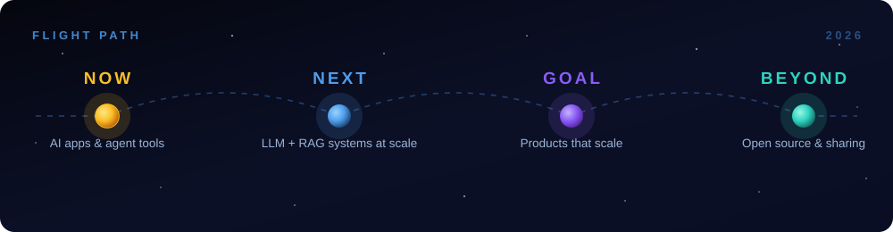

<h1>
  
</h1>

  
  
  
  
  
  

  
  
  

<h2>🌌 Mission Log</h2>

Hey — I'm **Muhammad Roman**, a practical **AI Engineer** and **Software Developer** who builds things that actually work. I like taking rough ideas and turning them into clean, usable products that solve everyday problems.

- 🔭 Currently building **AI-powered apps**, **agentic tools** & **cross-platform mobile apps**
- 📱 **Flutter** is my go-to for smooth, cross-platform mobile experiences
- 🤖 Exploring **LLMs**, **RAG**, and pragmatic **AI automation**
- 💡 Focused on readable code, simple architecture, and real results
- 🤝 Open to **freelance**, **remote** or **full-time** opportunities
- 📍 Based in **Peshawar, Pakistan**

<h2>🧩 What I Build</h2>

|  | Area | I turn ideas into |
|---|---|---|
| 🤖 | **AI Systems** | LLM apps, **RAG** pipelines & computer-vision models (**YOLOv8**) |
| 📱 | **Mobile Apps** | **Flutter** apps that feel native on every platform |
| 🌐 | **Full-Stack Products** | Web apps, dashboards & APIs — from database to deploy |

<h2>🪐 Tech Orbit</h2>

**☀️ Core — Languages**

  

**🌍 Near Orbit — Mobile & Web**

  

**🪐 Far Orbit — Backend & Data**

  

**🌠 Deep Space — AI & ML**

  
  
  
  

**🛰️ Mission Tools**

  

<h2>🛰️ Current Trajectory</h2>

<i>From first Flutter screen to production AI systems — steady orbit, continuously improving.</i>

<h2>🚀 Featured Missions</h2>

  
  

  
  

📁 <b>Full mission archive</b> — every project, at a glance

 

| 🛰️ Mission | What it does | Tech |
|---|---|---|
| **[Halal-Guard](https://github.com/Romankhanfx01/Halal-Guard)** | Detects non-halal ingredients using YOLOv8 & suggests halal alternatives | Flutter • Firebase • YOLOv8 • Python |
| **[world-news-channel-](https://github.com/Romankhanfx01/world-news-channel-)** | AI news agent that summarizes real-time news in a clean UI | Python • LangChain • Streamlit |
| **[task-manager](https://github.com/Romankhanfx01/task-manager)** | Clean Flutter task app with auth, lists & real-time sync | Flutter • Dart • Firebase |
| **[taar-clone-creative](https://github.com/Romankhanfx01/taar-clone-creative)** | Modern React + TypeScript UI with MySQL backend structure | TypeScript • React • MySQL |
| **[portfolio](https://romankhanfx01.github.io/portfolio/)** | Minimal personal portfolio built to showcase my work | HTML • CSS • JavaScript |

<h2>⚡ How I Work</h2>

- 🧱 **Working beats perfect** — ship small, iterate fast, learn from real usage
- 📖 **Readable code over clever code** — future me is a teammate too
- 🧭 **Simple architecture first** — scale it when it actually hurts
- 📏 **Measure, don't guess** — let data make the decisions
- 🎯 **Build for real users** — every project solves a real, everyday problem

<h2>📡 Mission Telemetry</h2>

  
  

  
  

  
  

  

  <picture>
    <source media="(prefers-color-scheme: dark)" srcset="https://raw.githubusercontent.com/Romankhanfx01/Romankhanfx01/output/github-contribution-grid-snake-dark.svg" />
    <source media="(prefers-color-scheme: light)" srcset="https://raw.githubusercontent.com/Romankhanfx01/Romankhanfx01/output/github-contribution-grid-snake.svg" />
    
  </picture>

<h2>🛸 Open a Channel</h2>

Got an idea, a project, or just want to talk? My inbox is always open.

  

   

  
  
  
  

    

  

